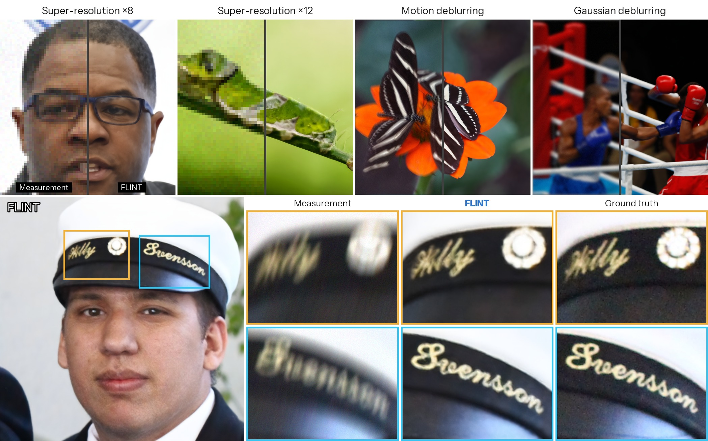
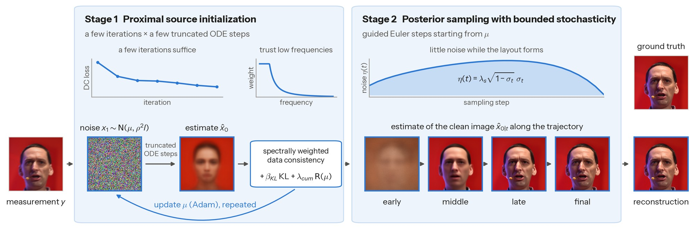

# [NeurIPS 2026] FLINT: Coupling Proximal Initialization and Bounded Stochasticity for Flow-Matching Inverse Problems

[Junseo Bang](), [Daewon Choi](), [Dong Ju Moon](), [Se Young Chun]()

Seoul National University

[Paper]() | [arXiv]() | [Project page]()



## Overview



FLINT solves linear inverse problems with a pre-trained flow-matching model (Stable Diffusion 3.5-Medium) and no additional training. The initial noise and the stochasticity of sampling are coupled. Once the initial noise is moderately close to a source-space solution (a typical Gaussian noise that the flow model maps to an image consistent with the measurement), optimizing it further brings little additional gain, but this head start can be eroded if too much noise accumulates during guided sampling. FLINT therefore works in two stages:

1. **Proximal source initialization.** A few iterations optimize the initial noise with a manifold-constrained proximal objective. Each iteration runs a few truncated ODE steps and uses a spectrally weighted data-consistency loss.
2. **Posterior sampling with bounded stochasticity.** Guided sampling starts from the optimized noise and injects noise with a bell-shaped schedule to help preserve the initialization advantage.

The whole solver takes under ten seconds per 768×768 image on a single A100 GPU.

## Quick Start

### Environment setup

```bash
git clone <this repository> FLINT
cd FLINT
conda create -n flint python=3.10
conda activate flint
pip install -r requirements.txt
```

FLINT uses [Stable Diffusion 3.5-Medium](https://huggingface.co/stabilityai/stable-diffusion-3.5-medium). Accept its license on Hugging Face and log in with `huggingface-cli login` before the first run.

For motion deblurring, clone the kernel generator into the repository root:

```bash
git clone https://github.com/LeviBorodenko/motionblur.git
```

### Examples

**Super-resolution ×8 / FFHQ**
```bash
python solve.py \
    --config configs/ffhq/sr8.yaml \
    --img_path samples/ffhq_example.png \
    --workdir results/ffhq_example
```

**Motion deblurring / DIV2K**
```bash
python solve.py \
    --config configs/div2k/deblur_motion.yaml \
    --img_path samples/div2k_example.png \
    --prompt "$(cat samples/div2k_example.txt)" \
    --workdir results/div2k_example
```

The measurement, the reconstruction and the ground truth are saved to `<workdir>/input`, `<workdir>/recon` and `<workdir>/label`.

## Tasks

| Task | FFHQ | DIV2K |
|---|---|---|
| Super-resolution ×8 (bicubic) | `configs/ffhq/sr8.yaml` | `configs/div2k/sr8.yaml` |
| Super-resolution ×12 (bicubic) | `configs/ffhq/sr12.yaml` | `configs/div2k/sr12.yaml` |
| Motion deblurring (61×61, intensity 0.5) | `configs/ffhq/deblur_motion.yaml` | `configs/div2k/deblur_motion.yaml` |
| Gaussian deblurring (σ = 3.0) | `configs/ffhq/deblur_gauss.yaml` | `configs/div2k/deblur_gauss.yaml` |

All measurements include Gaussian noise with σ<sub>y</sub> = 0.03. Every entry of a config can also be set from the command line, e.g. `--stage2_steps 9` runs FLINT with 30 NFEs in total.

## Reproducing the paper

Place the evaluation images ([FFHQ](https://github.com/NVlabs/ffhq-dataset) and the [DIV2K](https://data.vision.ee.ethz.ch/cvl/DIV2K/) training set) as follows:

```
data/
├── ffhq/               # FFHQ 00000.png – 00999.png (1024×1024)
├── div2k/              # DIV2K training set 0001.png – 0800.png
└── div2k_prompts.txt   # DAPE captions for DIV2K (provided)
```

Run a task, then compute PSNR, SSIM, LPIPS and patch-based FID:

```bash
python solve.py --config configs/ffhq/sr8.yaml --workdir results/ffhq_sr8
python eval.py --path1 results/ffhq_sr8/label --path2 results/ffhq_sr8/recon --metric psnr ssim lpips fid
```

Each image has its own seed, so the dataset can be split across GPUs without changing the results:

```bash
for g in 0 1 2 3; do
    CUDA_VISIBLE_DEVICES=$g python solve.py --config configs/ffhq/sr8.yaml --workdir results/ffhq_sr8 \
        --start_idx $((g * 250)) --num_samples 250 &
done
wait
```

## Citation

```bibtex
@inproceedings{bang2026flint,
  title     = {{FLINT}: Coupling Proximal Initialization and Bounded Stochasticity for Flow-Matching Inverse Problems},
  author    = {Bang, Junseo and Choi, Daewon and Moon, Dong Ju and Chun, Se Young},
  booktitle = {Advances in Neural Information Processing Systems},
  year      = {2026}
}
```

## Acknowledgements

This code builds on [FlowDPS](https://github.com/FlowDPS-Inverse/FlowDPS). The SVD-based degradation operators are adapted from [DDRM](https://github.com/bahjat-kawar/ddrm) and [DDPG](https://github.com/tirer-lab/DDPG), and motion-blur kernels are generated with [motionblur](https://github.com/LeviBorodenko/motionblur).
